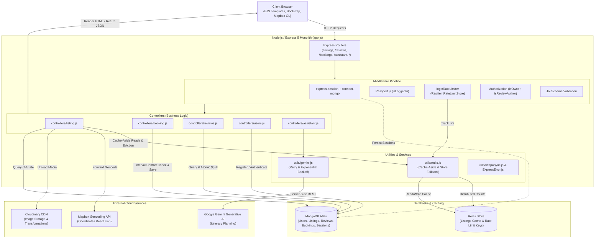

# Wanderlust

> A full-stack vacation rental marketplace and AI-powered travel planning platform built with Node.js, Express 5, MongoDB Atlas, and Redis.

[](https://github.com/ekta1912/Wanderlust)
[](package.json)
[](package.json)
[](package.json)
[](package.json)

---

## 1. Project Overview

**Wanderlust** is a production-oriented, full-stack vacation rental platform inspired by Airbnb. It bridges property owners (hosts) and travelers (guests), providing end-to-end functionality for listing properties, interactive map-based location exploration, media hosting with on-the-fly transformations, community reviews, and a concurrency-aware booking engine.

In addition to traditional hospitality features, Wanderlust incorporates modern backend engineering patterns:
- **Cache-Aside Caching** via Redis to optimize read latency on the primary catalog.
- **Resilient Distributed Rate Limiting** with automatic zero-downtime fallback to an in-memory store if Redis is unavailable.
- **Google Gemini AI Integration** for context-aware, day-wise travel itinerary generation and local guide discovery.

---

## 2. Problem Statement & Objectives

### The Problem
Building a reliable accommodation platform introduces several distributed systems challenges:
1. **High Read Latency:** Catalog pages experience frequent read traffic compared to infrequent writes, putting unnecessary load on primary databases.
2. **Double-Booking Collisions:** Concurrent guest requests for overlapping dates can result in data inconsistencies without proper interval validation and query indexing.
3. **Security Vulnerabilities:** Public authentication endpoints are prime targets for automated credential stuffing and brute-force attacks.
4. **Third-Party API Fragility:** External dependencies (geocoding, generative AI, cloud media storage) can fail, run out of quota, or introduce latency if not isolated behind server-side defensive wrappers.

### Objectives
- Deliver an MVC-based monolithic web application with server-side rendering (SSR) using Express 5 and EJS.
- Guarantee relational integrity across non-relational MongoDB collections (e.g., cascading review deletions and host-guest authorization).
- Accelerate read throughput using Redis caching while maintaining strong cache invalidation on write mutations.
- Enforce brute-force protection using a resilient rate-limiting layer that gracefully degrades if cache infrastructure experiences outages.
- Provide server-isolated AI trip planning with exponential backoff on server errors and quota exhaustion safeguards.

---

## 3. Key Implemented Features

* **Property Listing Management (CRUD):**
  - Authenticated hosts can create, edit, view, and delete property listings with titles, descriptions, pricing, locations, and countries.
  - Image files uploaded via Multer are streamed directly to Cloudinary; thumbnails in edit forms utilize dynamic URL transformations (`/upload/w_250`) to minimize bandwidth consumption.
* **Forward Geocoding & Interactive Maps:**
  - Automated translation of textual addresses into GeoJSON coordinates (`Point [longitude, latitude]`) via the Mapbox Geocoding SDK.
  - Dynamic client-side map rendering using Mapbox GL JS with custom location markers and interactive popups.
* **Community Reviews & Cascading Deletions:**
  - Authenticated guests can submit 1-to-5 star ratings with comments using accessible Starability controls.
  - Review deletion utilizes MongoDB's atomic `$pull` operator to prune references from the parent listing.
  - Deleting a listing automatically triggers a Mongoose `post("findOneAndDelete")` hook to delete all associated review documents.
* **Dual-Sided Booking Engine & Conflict Prevention:**
  - Guests select check-in and check-out dates; the server validates that dates are not in the past and that check-out succeeds check-in.
  - Total pricing is automatically computed based on duration (nights) and nightly rates.
  - **Overlapping Booking Prevention:** Validates against existing active reservations using interval overlap logic (`checkIn < newCheckOut && checkOut > newCheckIn`).
  - Compound indexing on `{ listing: 1, checkIn: 1, checkOut: 1 }` guarantees rapid index scans.
  - Dual dashboard: Guests can view trip statuses and cancel bookings; Hosts can accept or decline pending reservation requests for their listings.
* **Redis Cache-Aside Architecture:**
  - Primary listings catalog (`GET /listings`) checks Redis key `listings:all` before querying MongoDB Atlas.
  - Write operations (`createListing`, `updateListing`, `destroyListing`) execute cache eviction (`delCache`), maintaining cache consistency.
* **Resilient Distributed Rate Limiting:**
  - Authentication routes (`POST /login`) are protected by a configurable rate limiter (default: 5 attempts per 15 minutes).
  - Custom `ResilientRateLimitStore` synchronizes counts across instances via Redis when available, but automatically degrades to process-local memory if Redis disconnects, preventing application downtime.
* **Google Gemini AI Travel Assistant:**
  - Server-side REST client communicating with Google Gemini Flash (`gemini-3.1-flash-lite`).
  - Supports dual workflows: custom multi-day travel itineraries and localized nearby attraction discovery.
  - Implements defensive handling: immediate abort on HTTP 429 quota exhaustion, capped exponential backoff (`(2 ** attempt) + 2` seconds) on 5xx server or connection errors, and a deterministic fallback simulation mode if API credentials are not set.
* **Health Check & Reverse Proxy Readiness:**
  - Dedicated `/health` endpoint returning server uptime, status, and ISO timestamp.
  - Configured with `app.set("trust proxy", 1)` for accurate client IP identification behind cloud load balancers and reverse proxies (e.g., Render, Nginx).

---

## 4. Screenshots

> *Add application screenshots below to demonstrate key user interfaces.*

| Explore Listings Catalog | Property Details & Interactive Map |
| :---: | :---: |
|  |  |

| Booking & Reservations Dashboard | AI Travel Assistant (Gemini Flash) |
| :---: | :---: |
|  |  |

---

## 5. Technology Stack

| Category | Technology | Purpose in Project |
| :--- | :--- | :--- |
| **Frontend** | EJS & EJS-Mate | Server-side templating with modular layouts and boilerplate inheritance |
| | Bootstrap 5.3.7 | Responsive UI grid, components, modals, and input styling |
| | Font Awesome 6.7.2 | Vector iconography across navigation, actions, and features |
| | Starability CSS | Pure CSS star rating radio components |
| | Vanilla JavaScript | Client-side form validation, AJAX requests via Fetch API, and clipboard copy |
| | Mapbox GL JS 3.13.0 | Client-side WebGL interactive map and popup rendering |
| **Backend** | Node.js (v22.x) | Asynchronous JavaScript runtime environment |
| | Express.js 5.1.0 | Monolithic web application framework handling HTTP routing and middleware |
| | Passport.js 0.7.0 | Authentication middleware with Local strategy |
| | Passport-Local-Mongoose 8.0.0 | PBKDF2 password hashing, salt generation, and credential serialization |
| | express-session & connect-mongo | Session middleware with persistent MongoDB-backed session storage |
| | Multer 2.0.2 | Multipart form-data parser for file uploads |
| | Joi 17.13.3 | Server-side schema validation for request bodies |
| | method-override 3.0.0 | RESTful PUT and DELETE HTTP verbs support in HTML forms |
| **Database & Cache** | MongoDB Atlas | Multi-cloud document database for entities and sessions |
| | Mongoose 8.16.1 | Object Data Modeling (ODM) library with schema validation and hooks |
| | Redis 6.2.1 | In-memory key-value data store for listing caching |
| | rate-limit-redis 6.0.1 | Distributed Redis store for Express rate limiting |
| | express-rate-limit 8.7.0 | IP-based request throttling and brute-force mitigation |
| **External Services** | Mapbox Geocoding API | Server-side text-to-coordinate forward geocoding |
| | Cloudinary CDN | Cloud media asset hosting, storage, and URL image transformation |
| | Google Gemini Flash API | Generative AI travel itinerary and local recommendation engine |
| **Utilities** | dotenv 17.2.0 | Environment variable management |
| | connect-flash 0.1.1 | Flash messaging for user feedback across redirects |

---

## 6. Application Architecture

Wanderlust follows the classical **Model-View-Controller (MVC)** architectural pattern within an Express.js monolith:



---

## 7. Main Application Workflows

### 1. User Registration & Session Initialization
1. User enters username, email, and password at `/signup`.
2. Controller invokes `User.register()`, which computes a cryptographic salt and hashes the password with PBKDF2.
3. The user document is persisted in MongoDB Atlas.
4. Passport's `req.login()` automatically serializes user identity into the session.
5. `connect-mongo` persists the session state, and the server sets an encrypted `connect.sid` HTTPOnly cookie before redirecting to `/listings`.

### 2. Listing Creation, Geocoding & Cache Eviction
1. Host submits a property form at `POST /listings` with text data and an image file.
2. `isLoggedIn` middleware verifies session authentication.
3. Multer directly streams the file to Cloudinary, resolving a secure URL and public ID.
4. Joi validates required field constraints (title, price, location).
5. Controller calls the Mapbox Geocoding API to resolve the location text into GeoJSON coordinates (`Point [lng, lat]`).
6. The listing is saved to MongoDB Atlas with the host assigned as `owner`.
7. `delCache("listings:all")` deletes the cached listings key in Redis so subsequent requests receive the latest catalog.

### 3. Concurrency-Aware Booking Creation
1. Guest requests dates on a listing (`POST /listings/:id/bookings`).
2. Server validates that `checkIn` is today or later, and that `checkOut` occurs after `checkIn`.
3. An interval query executes against MongoDB:
   ```javascript
   Booking.findOne({
     listing: id,
     status: { $in: ["Pending", "Accepted"] },
     checkIn: { $lt: checkOutDate },
     checkOut: { $gt: checkInDate }
   });
   ```
4. If a conflict exists, the request aborts with an informative flash error.
5. If clear, the stay duration and total price are calculated, and a `Pending` booking is created.
6. The host can inspect incoming bookings on their dashboard and update the status to `Accepted` or `Declined`.

### 4. AI Travel Assistant Planning
1. User inputs a starting point, destination, budget, and duration on `/assistant`.
2. Client-side JavaScript submits an asynchronous JSON request to `POST /assistant/plan`.
3. The server checks for a configured `GEMINI_API_KEY`. If unconfigured, it returns a simulated structured plan.
4. If configured, a structured prompt is dispatched to Google Gemini Flash.
5. If the request encounters a 429 quota code, retries abort immediately to preserve resources.
6. If the request encounters 5xx server errors or transient socket issues, it retries up to 3 times with exponential backoff (`waitTime = (2 ** attempt) + 2` seconds).
7. The resulting plan is returned as JSON, parsed from markdown, and rendered dynamically without a page reload.

---

## 8. Project Folder Structure

```
Wanderlust/
├── controllers/            # Application business logic (MVC Controllers)
│   ├── assistant.js        # Handles AI itinerary and local guide requests
│   ├── booking.js          # Handles booking validation, conflict checks, and state transitions
│   ├── listing.js          # Handles listing CRUD, Redis cache reads/invalidation, geocoding
│   ├── reviews.js          # Handles review creation and reference removal ($pull)
│   └── users.js            # Handles signup, login, session redirects, and logout
├── init/                   # Database initialization and mock data
│   ├── data.js             # Seed sample data for listings
│   └── index.js            # Standalone migration script to seed MongoDB
├── models/                 # Mongoose schemas and data models
│   ├── booking.js          # Booking schema with status enum and compound index
│   ├── listing.js          # Listing schema with GeoJSON point and cascade delete hook
│   ├── review.js           # Review schema with rating limits (1-5) and author reference
│   └── user.js             # User schema with passport-local-mongoose plugin
├── public/                 # Static assets served by Express
│   ├── css/
│   │   ├── rating.css      # Starability rating stylesheet
│   │   └── style.css       # Custom styles, responsive tweaks, and navbar theming
│   └── js/
│       ├── map.js          # Client-side Mapbox GL JS map and marker initialization
│       └── script.js       # Bootstrap client-side form validation listeners
├── routes/                 # Express route definitions
│   ├── assistant.js        # Routes for /assistant (render, plan, nearby)
│   ├── booking.js          # Routes for /listings/:id/bookings and /bookings
│   ├── listing.js          # Routes for /listings (index, new, show, edit, update, delete)
│   ├── review.js           # Routes for /listings/:id/reviews (mergeParams enabled)
│   └── user.js             # Routes for /signup, /login (rate-limited), and /logout
├── utils/                  # Reusable utilities and service helpers
│   ├── ExpressError.js     # Custom Error class extending Error with statusCode
│   ├── gemini.js           # Google Gemini client with retry, backoff, and simulation fallbacks
│   ├── redis.js            # Redis client wrapper, cache methods, and ResilientRateLimitStore
│   └── wrapAsync.js        # Async error propagation higher-order wrapper
├── views/                  # EJS server-rendered templates
│   ├── assistant/          # AI assistant interactive interface
│   ├── bookings/           # User trips and host reservation management views
│   ├── includes/           # Partials: navbar.ejs, footer.ejs, flash.ejs
│   ├── layouts/            # Layout wrapper: boilerplate.ejs
│   ├── listings/           # Views: index.ejs, show.ejs, new.ejs, edit.ejs
│   ├── users/              # Views: login.ejs, signup.ejs
│   └── error.ejs           # Centralized error display template
├── app.js                  # Main server entry point and middleware pipeline configuration
├── cloudConfig.js          # Cloudinary configuration and Multer Cloudinary storage engine
├── middleware.js           # Authentication guards, authorization checks, Joi validation, rate limiter
├── package.json            # Project dependencies, engines (Node 22.x), and start scripts
└── schema.js               # Joi validation schemas for listings and reviews
```

---

## 9. Database Models & Schema Relationships

```
+------------------------------------+          +------------------------------------+
|               User                 |          |              Listing               |
+------------------------------------+          +------------------------------------+
| _id: ObjectId                      | 1      N | _id: ObjectId                      |
| email: String (required)           |<---------| title: String                      |
| username: String (via plugin)      |   owner  | description: String                |
| hash: String (PBKDF2 encrypted)    |          | image: { url, filename }           |
| salt: String (cryptographic salt)  |          | price: Number                      |
+------------------------------------+          | location: String                   |
      | 1                                       | country: String                    |
      |                                         | owner: ObjectId -> User            |
      | author                                  | reviews: [ObjectId -> Review]      |
      v N                                       | geometry: {                        |
+------------------------------------+          |   type: "Point",                   |
|               Review               |          |   coordinates: [Number]            |
+------------------------------------+          | }                                  |
| _id: ObjectId                      |          +------------------------------------+
| comment: String                    |                            | 1
| rating: Number (1 - 5)             |                            |
| createdAt: Date                    |                            | listing
| author: ObjectId -> User           |                            v N
+------------------------------------+          +------------------------------------+
                                                |              Booking               |
                                                +------------------------------------+
                                                | _id: ObjectId                      |
                                                | listing: ObjectId -> Listing       |
                                                | user: ObjectId -> User (Guest)     |
                                                | checkIn: Date                      |
                                                | checkOut: Date                     |
                                                | totalPrice: Number                 |
                                                | status: "Pending"|"Accepted"|...   |
                                                | createdAt: Date                    |
                                                +------------------------------------+
                                                INDEX: { listing: 1, checkIn: 1, checkOut: 1 }
```

---

## 10. Installation & Local Setup

### Prerequisites
- **Node.js:** Version `22.x` is required (enforced via `package.json` engines).
- **npm:** Node Package Manager (bundled with Node.js).
- **MongoDB:** Active MongoDB Atlas cluster or a running local MongoDB instance.
- **Redis (Optional but Recommended):** Local Redis server or cloud Redis (e.g., Upstash). *Note: The application runs cleanly in standalone mode without Redis by utilizing in-memory fallbacks.*

### Step 1: Clone the Repository
```bash
git clone https://github.com/ekta1912/Wanderlust.git
cd Wanderlust
```

### Step 2: Install Dependencies
```bash
npm install
```

### Step 3: Configure Environment Variables
Create a `.env` file in the root directory:
```bash
touch .env
```
Populate `.env` with the required keys (refer to the [Environment Variables](#11-environment-variables) section below).

### Step 4: Seed the Database (Optional)
To populate the database with initial accommodation listings:
```bash
node init/index.js
```

---

## 11. Environment Variables

All sensitive credentials and connection strings must be configured via `.env`.

| Variable Name | Required | Default / Example Value | Description |
| :--- | :---: | :--- | :--- |
| `PORT` | No | `8080` | Port on which the Express server listens. |
| `NODE_ENV` | No | `development` | Set to `production` when deployed. |
| `ATLASDB_URL` | **Yes** | `mongodb+srv://<user>:<password>@cluster.mongodb.net/?appName=Cluster0` | MongoDB Atlas connection URI. |
| `SECRET` | **Yes** | `your_long_session_signing_secret` | Symmetric secret key used to sign session cookies and encrypt session store. |
| `CLOUD_NAME` | **Yes** | `your_cloudinary_cloud_name` | Cloudinary Cloud Name for media storage. |
| `CLOUD_API_KEY` | **Yes** | `your_cloudinary_api_key` | Cloudinary API Key. |
| `CLOUD_API_SECRET` | **Yes** | `your_cloudinary_api_secret` | Cloudinary API Secret. |
| `MAP_TOKEN` | **Yes** | `pk.your_mapbox_public_token` | Mapbox public access token for geocoding and Mapbox GL JS rendering. |
| `REDIS_URL` | No | `rediss://default:<password>@<host>:<port>` | Redis connection string for distributed caching and rate limiting. |
| `LISTINGS_CACHE_TTL_SEC` | No | `3600` | Expiration time (in seconds) for the cached listings catalog in Redis. |
| `LOGIN_RATE_LIMIT_WINDOW_MS`| No | `900000` (15 min) | Time window in milliseconds for login attempt rate limiting. |
| `LOGIN_RATE_LIMIT_MAX` | No | `5` | Maximum failed login requests permitted per IP inside the window. |
| `GEMINI_API_KEY` | No | `your_gemini_api_key` | Google Gemini API Key. If absent, a simulated plan is returned. |
| `GEMINI_MODEL` | No | `gemini-3.1-flash-lite` | Gemini model variant identifier. |

> **Security Notice:** Never commit `.env` to version control. The repository includes `.gitignore` to prevent sensitive credentials from being committed.

---

## 12. Running the Application

### Start in Production Mode
```bash
npm start
```
*Executes `node app.js` on port `8080` (or `process.env.PORT`).*

### Verify Server Health
Once started, visit:
```
http://localhost:8080/health
```
Expected response:
```json
{
  "status": "ok",
  "uptime": 12.45,
  "timestamp": "2026-10-11T17:30:00.000Z"
}
```

Visit `http://localhost:8080` in your browser. The application will redirect to `http://localhost:8080/listings`.

---

## 13. Deployment & Verified Links

- **GitHub Repository:** [https://github.com/ekta1912/Wanderlust](https://github.com/ekta1912/Wanderlust)
- **Live Deployment:** `[Add Live URL here if deployed (e.g. Render/Railway)]`

### Deployment Notes:
- The project includes `app.set("trust proxy", 1)` to support reverse proxies on platforms such as Render, Railway, or AWS Elastic Beanstalk.
- MongoDB sessions use `touchAfter: 24 * 3600`, reducing database write load on unchanged sessions.
- Node.js version is explicitly declared in `package.json` (`"engines": { "node": "22.x" }`), ensuring consistent builds across PaaS buildpacks.

---

## 14. Security Considerations & Known Limitations

### Security Implementations
- **Credential Storage:** User passwords are never stored in plaintext; `passport-local-mongoose` uses PBKDF2 with unique cryptographic salts.
- **Session Protection:** Session cookies are configured with `httpOnly: true`, preventing client-side script access and mitigating Cross-Site Scripting (XSS) session theft.
- **Distributed Brute-Force Defense:** Rate limiting on `/login` throttles aggressive dictionary and credential-stuffing attacks.
- **Server-Side Request Isolation:** Cloudinary, Mapbox geocoding, and Gemini AI operations are authenticated on the backend; secret keys are never passed to the client browser.
- **Strict Authorization:** Middleware explicitly asserts ownership (`listing.owner.equals(currUser._id)`) before allowing edit or delete operations.

### Known Limitations
- **Booking Race Conditions Under High Concurrency:** While the database query filters out overlapping intervals, two requests submitted in the exact same millisecond could both read an empty interval before writing. Solving this completely requires MongoDB multi-document ACID transactions or distributed locking via Redis (Redlock).
- **CSRF Protection:** HTML forms rely on session authentication and method overrides, but do not currently enforce CSRF tokens (e.g., via `csurf` or double-submit cookies).
- **Pagination:** The listings catalog and review lists render all items without pagination or infinite scroll, which could impact memory on very large datasets.

---

## 15. Future Improvements

The following items are planned architectural enhancements:

1. **Distributed Locking:** Implement Redis-based distributed locks (Redlock) or MongoDB transactions during the booking confirmation phase to eliminate concurrent double-booking race conditions.
2. **Payment Gateway Integration:** Connect Stripe or Razorpay webhooks for online transaction processing and automated booking state transitions upon payment receipt.
3. **Cursor-Based Pagination:** Implement cursor-based pagination for the `GET /listings` endpoint to optimize database queries as catalog sizes grow.
4. **Automated Testing Suite:** Add unit tests with Mocha/Chai or Jest, Supertest for integration testing of API routes, and Cypress for end-to-end user journey verification.
5. **Security Hardening:** Add Helmet.js for security headers, CSRF token validation, and HTML sanitization on user comments.

---

## License

This project is licensed under the [ISC License](package.json).
